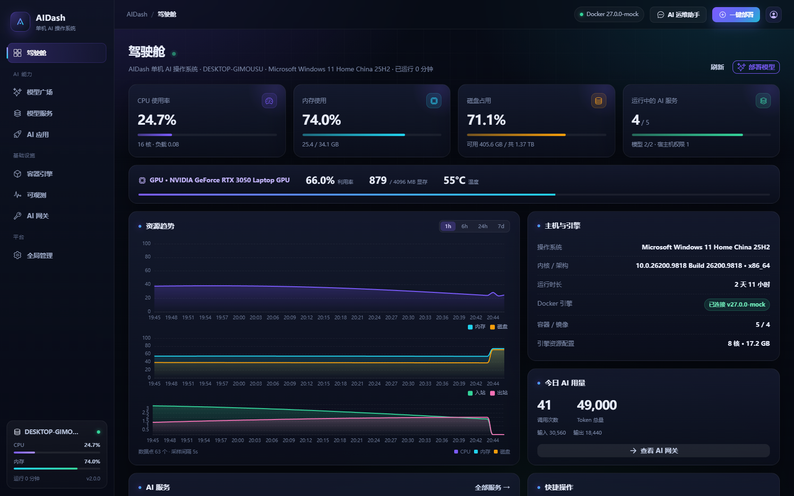
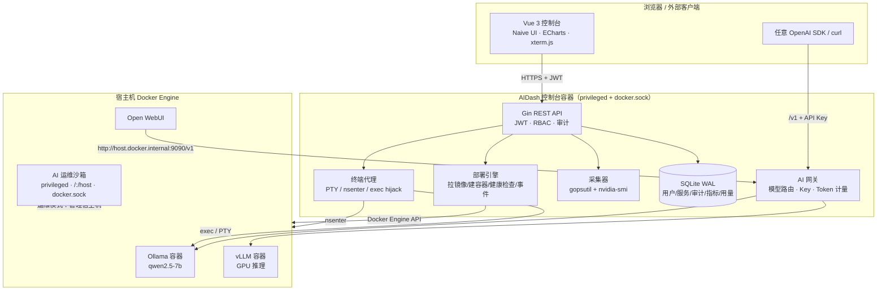
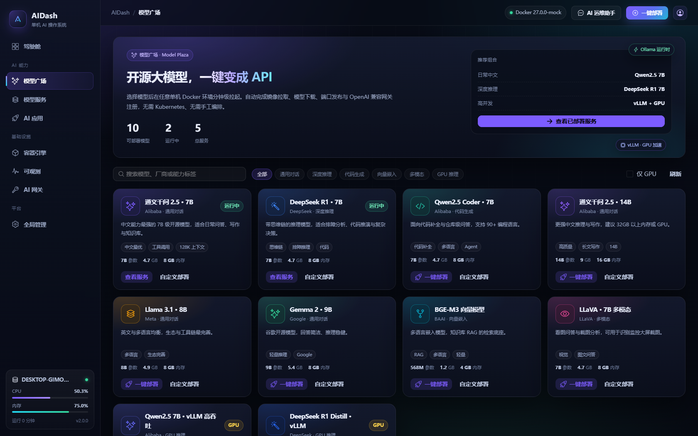
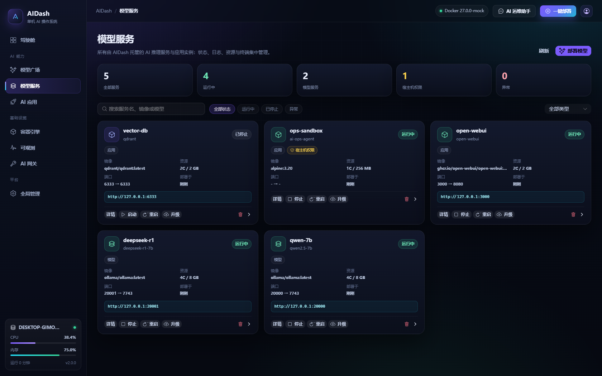
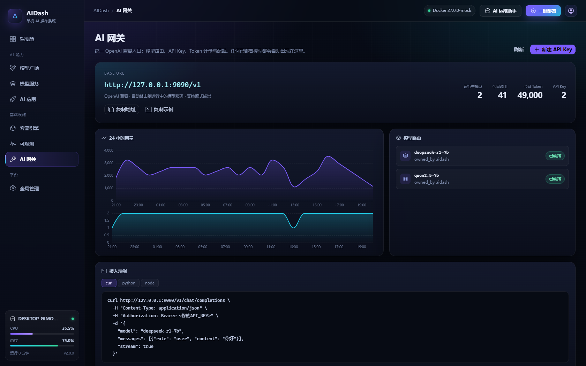
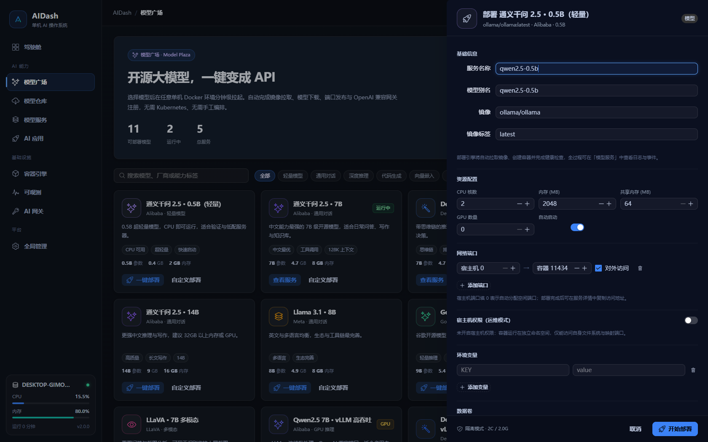
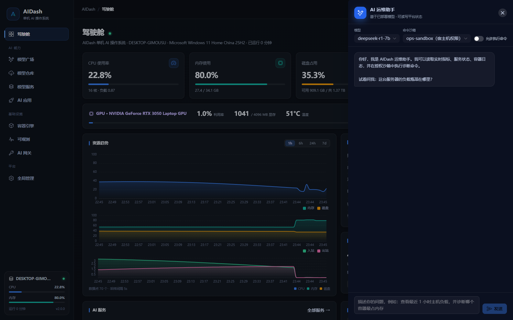
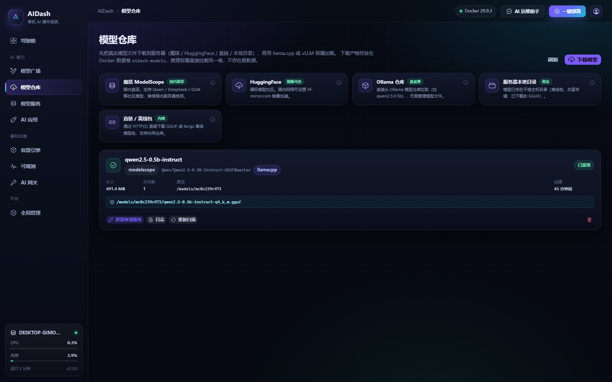
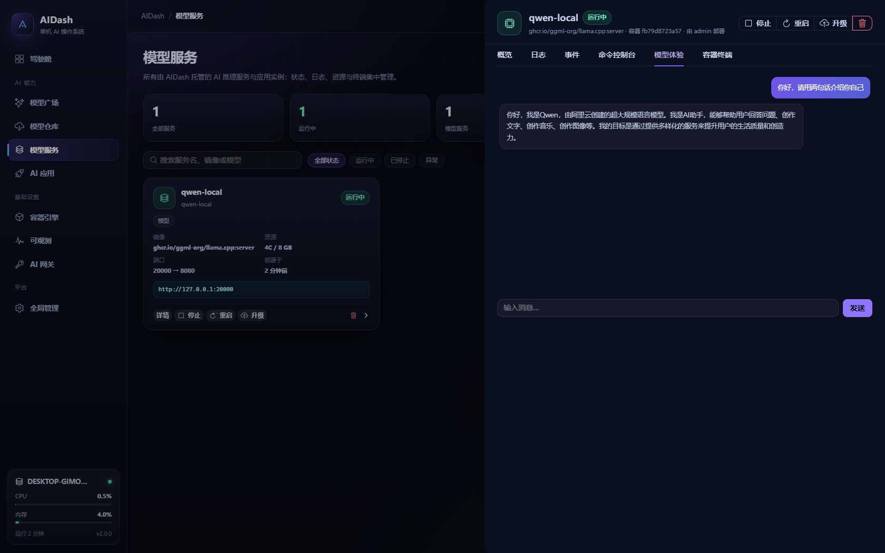

# AIDash · 单机 AI 操作系统（Docker 版）

<p align="center">
  
  
  
  
  
</p>

> 把一台 Linux 服务器变成「AI 操作系统」：模型广场、模型仓库、模型服务、AI 应用、容器引擎、可观测、AI 网关与权限体系，
> 全部收敛到一个面板里。**不需要 Kubernetes，完全基于 Docker Engine API 实现单机编排。**
>
> 本项目由 [gxfdev/DevDash](https://github.com/gxfdev/DevDash) 运维面板改造而来，保留其主机采集、终端与鉴权能力，
> 重新设计了模块边界、部署引擎、AI 网关和全部前端界面。



> **真实推理，不是演示字幕。** 模型权重从魔搭 / HuggingFace / 直链真实下载到服务器，
> 以只读方式挂载进 llama.cpp、vLLM 或 Ollama 容器，网关返回的是模型的实际输出。
> 仓库里的 `cmd/demo`（内存 Docker + 假模型）只用于无 Docker 环境预览界面，**不是部署路径**。

---

## 模型来源与真实部署

部署模型只做两件事：**先拿到真实权重，再用容器加载**。AIDash 把这两步做成一条流水线：

```
模型仓库（下载） → 数据卷 aidash-models （或服务器本地目录）
        ↓
推理容器：llama.cpp（GGUF/CPU 可用）/ vLLM（GPU）/ Ollama
        ↓
AI 网关 /v1/chat/completions → 真实模型输出 + Token 计量
```

### 支持的模型来源

| 来源 | 适合场景 | 填写内容 | 默认引擎 |
| --- | --- | --- | --- |
| **魔搭 ModelScope** | 国内服务器（推荐） | 模型 ID，如 `Qwen/Qwen2.5-0.5B-Instruct-GGUF`，可选文件名 `*.gguf` | llama.cpp / vLLM |
| **HuggingFace** | 国际社区，国内可用镜像 | 模型 ID + Revision，默认镜像 `hf-mirror.com`，私有仓库填 HF Token | llama.cpp / vLLM |
| **Ollama 仓库** | 最省事，不想管文件 | `qwen2.5:0.5b`、`deepseek-r1:7b` 等 | Ollama |
| **服务器本地目录** | 离线包、共享存储、已下载权重 | 宿主机绝对路径，如 `/opt/models/qwen2.5-0.5b` | llama.cpp / vLLM |
| **直链 / 离线包** | 内网 HTTP 仓库 | GGUF 或 `.tar.gz` 直链，自动解压 | 自动识别 |

### 操作步骤（控制台）

1. 左侧「模型仓库」→ 选择来源 → 填写模型 ID / 目录 / 直链；
2. 选择引擎（GGUF 选 llama.cpp，HuggingFace 全量权重选 vLLM）；
3. 等待下载：进度、日志、文件数实时展示，完成后自动识别 `.gguf`；
4. 点「部署推理服务」：服务名、模型别名、CPU/内存/GPU，一键创建真实推理容器；
5. 在「模型服务 → 模型体验」或 AI 网关 `/v1` 直接对话，返回真实生成内容。

### 国内网络建议

- Python 依赖默认清华源：`PIP_INDEX_URL=https://pypi.tuna.tsinghua.edu.cn/simple`；
- llama.cpp 镜像在 `ghcr.io`，国内可设置 `AIDASH_IMAGE_MIRROR=ghcr.m.daocloud.io`，或先在宿主机执行：
  ```bash
  docker pull ghcr.m.daocloud.io/ggml-org/llama.cpp:server
  docker tag ghcr.m.daocloud.io/ggml-org/llama.cpp:server ghcr.io/ggml-org/llama.cpp:server
  ```
  AIDash 检测到本地镜像后会跳过拉取（离线环境同样适用）；
- Docker Hub 镜像可配置 `registry-mirrors`（如 `docker.1ms.run`、`docker.m.daocloud.io`）；
- 模型文件存放在 Docker 卷 `aidash-models`，删除服务不会删除权重；`docker volume inspect aidash-models` 可查看宿主机路径。

> 内网离线部署：镜像可用 `docker save/load` 分发；模型可用「服务器本地目录」或「直链 / 离线包」导入。

---

## 目录

- [它解决什么问题](#它解决什么问题)
- [模块划分](#模块划分)
- [核心能力](#核心能力)
- [架构](#架构)
- [一键部署](#一键部署)
- [本地开发与演示模式](#本地开发与演示模式)
- [宿主机权限模型（重点）](#宿主机权限模型重点)
- [AI 网关](#ai-网关)
- [API 速览](#api-速览)
- [验证结果](#验证结果)
- [目录结构](#目录结构)
- [安全建议](#安全建议)
- [常见问题](#常见问题)
- [来源与许可](#来源与许可)

---

## 它解决什么问题

在一台服务器上跑开源大模型，通常要手工做这些事：

1. 拉镜像、写 `docker run` / compose、挂 GPU、配共享内存；
2. 下载模型权重（Ollama / HuggingFace），等待、排错；
3. 暴露端口、配置 OpenAI 兼容接口、发 API Key；
4. 管理生命周期：启停、升级、日志、进容器排障；
5. 监控 CPU / 内存 / 磁盘 / GPU 和每个实例的资源占用；
6. 给团队分配账号、审计操作、控制 Token 成本。

AIDash 把这些步骤做成一个 **单机 AI 操作系统**：模型广场里点一下「一键部署」，
后台自动完成镜像拉取 → 容器创建 → 模型下载 → 健康检查 → 网关注册，全程有事件流和日志可查。

同时，它保留了「平台级运维」能力：面板自身运行在容器里，通过 Docker Socket 管理宿主机，
并且可以为指定的 AI 工作负载开启 **运维模式**（特权容器 + 宿主机根目录 + host PID + Docker Socket），
让容器化的 AI 应用在保持隔离边界的同时，获得受控的服务器访问权限。

---

## 模块划分

| 模块 | 职责 | 关键能力 |
| --- | --- | --- |
| 驾驶舱 | 平台总览 | 资源趋势、服务状态、Token 用量、告警、快捷操作 |
| 模型广场 | 模型目录 | 一键部署 Ollama / vLLM 模型，资源、端口、环境变量可调 |
| 模型仓库 | 模型文件管理 | 魔搭 / HuggingFace / Ollama 仓库 / 本地目录 / 直链下载真实权重 |
| 模型服务 | 生命周期 | 启动、停止、升级、日志、事件、命令控制台、容器终端、在线体验 |
| AI 应用 | 应用模板 | Open WebUI、LobeChat、n8n、向量库、数据工具、运维沙箱 |
| 容器引擎 | Docker 管理 | 容器、镜像、网络、数据卷，直接调用 Docker Engine API |
| 可观测 | 监控 | 主机指标、GPU、服务健康、Docker 存储占用 |
| AI 网关 | OpenAI 兼容入口 | 模型路由、API Key、Token 计量、配额 |
| 全局管理 | 平台治理 | 用户、角色、审计日志、平台设置 |
| 运维助手 | 智能排障 | 读取指标 / 日志 / 服务状态，在授权沙箱内执行命令 |

---

## 核心能力

### 模型广场
- 精选 11 个可部署模型（含 0.5B CPU 轻量模型）：Qwen2.5 7B/14B、DeepSeek R1、Qwen2.5-Coder、Llama 3.1、Gemma 2、BGE-M3、LLaVA、vLLM 高吞吐版本
- 一键部署：自动拉镜像 → 起容器 → `ollama pull` 模型 → 健康检查 → 网关可见
- 部署面板可调 CPU / 内存 / 共享内存 / GPU 数量 / 端口 / 环境变量 / 数据卷
- 宿主机权限开关，逐项控制特权、host PID、根目录挂载、Docker Socket

### 模型仓库
- 从魔搭 / HuggingFace / Ollama 仓库 / 服务器本地目录 / 直链下载真实权重
- 下载进度、日志、文件数与 GGUF 自动识别；面板重启自动恢复任务
- 下载产物落在 Docker 卷 `aidash-models`，推理容器直接挂载

### 模型服务
- 统一列出模型与应用实例，状态（排队/拉取/下载/启动/运行/停止/异常）与健康检查
- 启停、重启、升级（重新拉取镜像并重建容器）、删除（可保留命名卷）
- 实时资源曲线、日志、事件时间线、命令控制台、浏览器内容器终端（xterm.js）
- 模型体验：直接与部署好的模型对话验证

### AI 应用
- Open WebUI、LobeChat、n8n、Qdrant、JupyterLab、Code Server、MinIO，以及 **AI 运维智能体**（默认拥有宿主机权限的沙箱）
- 所有应用自动接入本机 AI 网关（`http://host.docker.internal:9090/v1`）

### 容器引擎
- 容器 / 镜像 / 网络 / 数据卷四个视图
- 容器启停、重启、日志、AIDash 托管标记、宿主机权限标记
- 镜像拉取（流式进度）、删除；网络创建/删除；数据卷清理

### 可观测
- 1h / 6h / 24h / 7d 的 CPU、内存、磁盘、网络、GPU 趋势
- 服务健康表、主机信息、Docker 存储占用（镜像/容器/卷）
- 指标落库 SQLite，默认保留 30 天

### AI 网关
- 统一 `/v1`：`chat/completions`、`completions`、`embeddings`、`models`
- API Key 鉴权（SHA-256 摘要存储）、按 Key 的 Token 配额
- Token 计量与按模型/按小时统计，支持流式 SSE 透明转发
- 内置 curl / Python / Node 接入示例

### AI 运维助手（Copilot）
- 使用已部署模型进行工具调用：主机指标、服务列表、服务日志、沙箱命令
- 可开关「允许执行命令」，命令仅在开启宿主机权限的容器内执行
- 每一步工具调用与结果都会展示，便于审计

### 平台管理
- 三角色 RBAC：`admin` / `operator` / `viewer`（只读账号被服务端强制拦截写操作）
- 全量审计日志：登录、部署、服务操作、容器命令、API Key、设置变更
- 首次启动自动创建管理员，JWT + bcrypt，安全响应头

---

## 架构



技术栈：

| 层 | 技术 |
| --- | --- |
| 后端 | Go 1.26 · Gin · SQLite（modernc，无 CGO） |
| Docker | Engine HTTP API（unix socket / Windows npipe / TCP），无 SDK 依赖 |
| 认证 | JWT（HS256）· bcrypt · API Key（SHA-256 + 前缀索引） |
| 前端 | Vue 3 · TypeScript · Naive UI · ECharts · xterm.js |
| 运行 | 单二进制 + 内嵌前端静态资源，镜像约 40 MB |

---

## 服务器要求

| 项目 | 最低配置 | 推荐配置 | 说明 |
| --- | --- | --- | --- |
| 操作系统 | Linux（Ubuntu 22.04+ / Debian 12+ / Rocky 9+），内核 5.10+ | Ubuntu 22.04 / 24.04 | 面板依赖 Docker，Windows 仅建议做开发预览 |
| 容器运行时 | Docker Engine 24+ + Docker Compose v2 | Docker 27+ | 面板通过 docker.sock 管理容器 |
| 权限 | root 或 docker 组 | root | compose 中面板使用 privileged + docker.sock |
| CPU | 4 核 | 8 核以上 | 0.5B 约 4 核即可；7B/14B CPU 推理建议 8-16 核 |
| 内存 | 8 GB | 32 GB+ | 0.5B≈2GB、7B q4≈8GB、14B q4≈16GB 可用内存 |
| 磁盘 | 30 GB | 100 GB+ SSD | 镜像约 2-5GB；0.5B 权重≈0.4GB、7B q4≈4.7GB、14B≈9GB |
| GPU | 可选 | NVIDIA 驱动 535+ + nvidia-container-toolkit | 仅 vLLM / llama.cpp CUDA 需要；CPU 用 llama.cpp 即可 |
| 端口 | 9090/tcp | 9090/tcp（可改） | 模型实例自动分配 20000-29999 端口 |
| 出站网络 | 可访问 pypi / 模型仓库 / 容器镜像仓库 | 配置国内镜像加速 | 模型下载默认走魔搭；HF 可配 hf-mirror.com |
| 浏览器 | Chrome / Edge 100+ | — | 终端使用 WebSocket |

> 面板容器以 root 运行并挂载 `/var/run/docker.sock` 与 `/:/host`，这是「一键部署容器 + 运维模式」的前提。
> 若安全策略不允许，可删除 `privileged`、`docker.sock` 与 `/:/host` 挂载，届时只能管理面板自身容器。

## 一键部署

### 方式零：拉取预构建镜像（推荐，服务器无需构建）

> 已发布：`ghcr.io/gxfdev/devdash:latest` 与 `ghcr.io/gxfdev/devdash:v2.0.0`，支持 linux/amd64 与 linux/arm64。

GitHub Actions 在每次推送到 `main` 时自动构建 **linux/amd64 + linux/arm64** 镜像并推送到 GHCR，
服务器只需要拉镜像启动，不需要 Node / Go 构建环境。

- 镜像：`ghcr.io/gxfdev/devdash:latest`
- 标签：`latest`（main）、`vX.Y.Z`（打 tag）、`sha-xxxxxxx`（提交）
- 工作流：`.github/workflows/publish.yml`

**一条命令启动（镜像公开时）：**

```bash
git clone git@github.com:gxfdev/DevDash.git aidash && cd aidash
JWT_SECRET=$(openssl rand -hex 32) \
  AIDASH_IMAGE=ghcr.io/gxfdev/devdash:latest \
  docker compose -f docker-compose.ghcr.yml up -d
```

**或使用安装脚本（会自动拉取镜像，不构建）：**

```bash
cp .env.example .env   # 填写 JWT_SECRET
./install.sh --image
```

访问 `http://服务器IP:9090`，默认 `admin / admin123`。

**镜像可见性**：GHCR 包默认私有。公开拉取前，在 GitHub → Packages → `devdash` → Package settings 中改为 Public；
若保持私有，服务器先登录：

```bash
echo "<GitHub PAT，勾选 read:packages>" | docker login ghcr.io -u <你的用户名> --password-stdin
```

**升级**：

```bash
# 预构建镜像
docker compose -f docker-compose.ghcr.yml pull && docker compose -f docker-compose.ghcr.yml up -d
# 或
./install.sh --image
```

**说明**：第一次推送 `main` 后需要等待 Actions 完成（约 5-15 分钟），在仓库 Actions 页面查看
`Publish Docker image` 是否成功；之后每次推送自动更新 `latest`。若服务器 `docker pull` 返回 401，
说明镜像还在构建或包仍是私有，按上面的可见性说明处理即可。

### 构建镜像

镜像为三阶段构建（前端 → Go → Alpine），运行时约 40 MB（模型镜像另行拉取）：

```bash
# 默认构建
docker build -t aidash:2.0.0 .

# 国内网络加速（npm / Go / Alpine 源）
docker build -t aidash:2.0.0 \
  --build-arg NPM_REGISTRY=https://registry.npmmirror.com \
  --build-arg GOPROXY=https://goproxy.cn,direct \
  --build-arg ALPINE_MIRROR=https://mirrors.tuna.tsinghua.edu.cn/alpine .

# 内网离线分发
docker save aidash:2.0.0 | gzip > aidash-image.tar.gz
# 目标机器
docker load < aidash-image.tar.gz
```

构建完成后，`docker compose up -d` 会直接使用 `aidash:latest`（compose 中同时声明了 build 与 image）。

### 方式一：docker compose（推荐）

```bash
git clone <你的仓库地址> aidash && cd aidash
./install.sh
```

或手动：

```bash
cp .env.example .env
# 必填：JWT_SECRET=$(openssl rand -hex 32)
docker compose up -d --build
```

访问 `http://服务器IP:9090`，默认 `admin / admin123`（登录后立即修改）。

面板容器以 `privileged + pid: host` 运行，并挂载了：

- `/var/run/docker.sock` —— 管理宿主机容器
- `/:/host:rw` —— 读写宿主机文件（运维助手、宿主机权限容器）
- `/proc`、`/sys`、`/dev` —— 采集宿主机指标与 GPU

> 如果只需要「模型部署 + 网关」而完全不需要宿主机权限，可以删除 `privileged`、`/:/host` 与 `docker.sock` 挂载，
> 但届时只能在宿主机上手动运行 AIDash 二进制来管理容器。

### 方式二：二进制

```bash
cd server && go build -o aidash ./cmd/server
JWT_SECRET=$(openssl rand -hex 32) ./aidash
# Linux 下默认连接 unix:///var/run/docker.sock
```

前端需要单独构建：`cd web && npm install && npm run build`，并把 `STATIC_DIR` 指向 `web/dist`。

### 方式三：演示模式（无需 Docker）

```bash
cd server
go run ./cmd/demo
# http://127.0.0.1:9090  admin / admin123
```

演示模式使用内存 Docker 引擎（内置 mock）和假模型上游，预置 5 个服务、24 小时指标与 Token 用量，
适合评估界面、跑 UI 测试或做演示。**它与真实部署共用同一套 API、部署引擎和网关代码。**

---

## 本地开发与演示模式

```bash
# 后端（热重载可选 air）
cd server && go run ./cmd/server

# 前端
cd web && npm install && npm run dev   # http://localhost:5173，代理到 9090
```

环境变量：

| 变量 | 默认 | 说明 |
| --- | --- | --- |
| `PORT` | `9090` | 监听端口 |
| `JWT_SECRET` | 自动生成到数据目录 | JWT 签名密钥 |
| `AIDASH_DATA_DIR` | `./data` | 数据目录 |
| `DB_PATH` | `$DATA_DIR/aidash.db` | SQLite 路径 |
| `DOCKER_HOST` | `unix:///var/run/docker.sock`（Windows 为 npipe） | Docker 引擎地址 |
| `ADMIN_USER` / `ADMIN_PASS` | `admin` / `admin123` | 首次启动创建的管理员 |
| `HOST_PROC` / `HOST_SYS` / `HOST_DEV` | 空 | 容器内采集宿主机指标 |
| `AIDASH_HOST_NS` | 空 | `1` 时终端通过 `nsenter` 进入宿主机命名空间 |
| `AIDASH_TARGET_OS` | 当前系统 | 宿主机权限挂载策略（引擎为 Linux 时设为 `linux`） |
| `PUBLIC_URL` | 自动 | 网关 Base URL 展示 |
| `CORS_ORIGINS` | 内置开发地址 | 允许的跨域来源 |

---

## 宿主机权限模型（重点）

需求是「部署的 AI 可以访问服务器权限，但仍然跑在容器里」。AIDash 用一层显式的 **运维模式（Host Access）** 实现：

```yaml
host_access:
  enabled: true            # 总开关
  privileged: true         # --privileged
  host_pid: true           # --pid=host
  mount_host_fs: true      # -v /:/host:rw
  mount_docker_socket: true# -v /var/run/docker.sock
```

开启后容器同时获得：

| 能力 | 实现 |
| --- | --- |
| 读写宿主机文件 | `/:/host:rw`，容器内 `/host/etc/...` |
| 管理宿主机容器 | Docker Socket + `DOCKER_HOST=unix:///var/run/docker.sock` |
| 查看宿主机进程 | `--pid=host` |
| 系统级操作 | `CapAdd: SYS_ADMIN, SYS_PTRACE, NET_ADMIN, SYS_CHROOT` + `seccomp=unconfined` |
| 进程/网络命名空间 | 面板终端 `nsenter -t 1 -m -u -i -n -p` 进入宿主机 |

安全边界：

- 默认 **关闭**。只有目录中标记「宿主机权限」的应用（如 AI 运维智能体）或用户手动开启才会授予；
- 部署面板中用醒目的黄色提示与二次确认展示；
- 服务列表、详情、容器页均显示「宿主机权限」徽标，便于审计；
- 审计日志记录部署参数与容器内执行的所有命令（Copilot / 控制台）；
- 建议只把该权限授予隔离网络中的可信 AI 应用，不要把宿主机端口直接暴露到公网。

---

## AI 网关

部署任意模型后，网关自动暴露 OpenAI 兼容接口：

```bash
curl http://127.0.0.1:9090/v1/chat/completions \
  -H "Content-Type: application/json" \
  -H "Authorization: Bearer sk-aidash-..." \
  -d '{
    "model": "qwen2.5-7b",
    "messages": [{"role": "user", "content": "你好"}],
    "stream": true
  }'
```

```python
from openai import OpenAI
client = OpenAI(base_url="http://127.0.0.1:9090/v1", api_key="sk-aidash-...")
print(client.chat.completions.create(
    model="qwen2.5-7b",
    messages=[{"role": "user", "content": "你好"}],
).choices[0].message.content)
```

路由规则：按 `model` 精确匹配服务的「模型别名」或服务名，未指定时使用第一个运行中的模型。
每次调用会记录 prompt/completion token、耗时、状态码，并在「AI 网关」页按小时/模型聚合展示。
流式请求按输出字符数估算 completion token（非流式优先使用上游 `usage`）。

---

## API 速览

所有接口以 `/api` 为前缀，除登录与 `/api/health` 外均需 `Authorization: Bearer <JWT>`。

| 模块 | 接口 |
| --- | --- |
| 认证 | `POST /auth/login`、`GET /auth/me`、`POST /auth/password` |
| 系统 | `GET /system/overview`、`/system/metrics?range=24h`、`/system/engine`、`/system/disk` |
| 目录 | `GET /catalog`、`GET /catalog/:id` |
| 服务 | `GET/POST /services`、`GET/DELETE /services/:id`、`POST /services/:id/action`、`/logs`、`/events`、`/stats`、`/exec` |
| 容器 | `GET /docker/containers`、`/docker/images`、`/docker/networks`、`/docker/volumes`、`POST /docker/images/pull` |
| 网关 | `GET /gateway`、`GET/POST /gateway/keys`、`DELETE /gateway/keys/:id` |
| Copilot | `POST /copilot/chat`（工具调用）、`POST /playground/chat`（面板内对话） |
| 管理 | `GET/POST/PATCH/DELETE /users`、`GET /audit`、`GET/PUT /settings` |
| OpenAI | `/v1/models`、`/v1/chat/completions`、`/v1/completions`、`/v1/embeddings` |
| WebSocket | `/ws/terminal`（宿主机）、`/ws/services/:id/terminal`（容器） |

角色：`admin` 全部；`operator` 可读写服务与部署；`viewer` 只读，写操作返回 403。

---

## 验证结果

### 真实环境验证（WSL2 Ubuntu 22.04 + Docker 29.9.3 + 真实模型）

| 步骤 | 实际结果 |
| --- | --- |
| 魔搭下载 | `Qwen/Qwen2.5-0.5B-Instruct-GGUF` → 491,400,032 字节 / 1 个文件，自动识别 GGUF |
| 容器部署 | llama.cpp server 镜像，4C/8G，端口 20000→8080，日志 `model loaded` / `listening on 0.0.0.0:8080` |
| 真实推理 | 网关 `/v1/chat/completions` 返回模型实际输出，usage: prompt 42 / completion 56；流式 SSE 同样返回真实 token |
| UI 验证 | 模型仓库、模型服务、模型体验、网关页面均通过 Playwright 检查，0 console error |

真实模型回复（节选）：

> 容器是一种虚拟的运行环境，它包含了一组预先安装好的软件和硬件资源……2+3的结果是5。

证据截图见 `docs/screenshots/real-*.png`。

### Mock 引擎验证（无 Docker 环境）

同时在无 Docker 的 Windows 开发机上通过 **mock Docker Engine** 完成全部部署/网关/RBAC 测试，
并用 Playwright 对真实前端 + 真实后端 + mock 引擎做 UI 自动化验证。

### Go 测试（`cd server && go test ./...`）

```
ok  github.com/gxfdev/aidash/server/internal/api           (登录/RBAC/服务/审计/设置/网关/容器 API)
ok  github.com/gxfdev/aidash/server/internal/engine        (镜像拉取/容器生命周期/日志解复用/stats/exec/删除)
ok  github.com/gxfdev/aidash/server/internal/orchestrator  (一键部署/模型下载/宿主机权限/网关代理/配额)
ok  github.com/gxfdev/aidash/server/internal/gateway       (Copilot 工具调用循环/命令授权拦截)
```

覆盖点：

- Docker 客户端：`_ping`、版本、拉取、创建、启动、inspect、日志流解复用、stats 计算、exec hijack、网络、删除
- 部署管线：提交 → 拉镜像 → 建容器 → 启动 → `ollama pull` → 健康检查 → running；事件与日志可查
- 运维模式：断言 `privileged`、`PidMode=host`、`/:/host:rw`、`docker.sock`、`SYS_ADMIN` 等落到了真实创建请求里
- 网关：API Key 鉴权、模型路由、Token 计量落库、配额 429、未知模型 404、无效 Key 401
- API：未授权 401、viewer 写操作 403、部署/停止/删除、审计记录、设置更新
- 前端：Vue 类型检查、生产构建、Playwright 全页面截图 + 一键部署 + 容器终端 + Copilot 对话

### UI 自动化（`cd web && node scripts/e2e.mjs`）

```json
{
  "steps": [
    "login ok",
    "deploy drawer opened: e2e-coder-156956 下载模型",
    "deployed service reached running state",
    "container terminal mounted: true",
    "copilot replied",
    "cleaned up 0 e2e service(s)"
  ],
  "consoleErrors": [],
  "pageErrors": [],
  "failedRequests": [],
  "ok": true
}
```

### 界面截图

| 驾驶舱 | 模型广场 |
| --- | --- |
|  |  |

| 模型服务 | AI 网关 |
| --- | --- |
|  |  |

| 部署面板 | AI 运维助手 |
| --- | --- |
|  |  |

真实环境（WSL2 + Docker 29.9.3，魔搭下载的 Qwen2.5-0.5B GGUF 运行在 llama.cpp 容器）：

| 模型仓库（真实下载 491MB） | 真实模型对话 |
| --- | --- |
|  |  |

---

## 目录结构

```
AIDash/
├── server/                          Go 后端
│   ├── cmd/server/main.go           生产入口（真实 Docker）
│   ├── cmd/demo/main.go             演示入口（内存 Docker + 演示数据）
│   └── internal/
│       ├── api/                     REST / OpenAI / WebSocket 路由与处理器
│       ├── auth/                    JWT、RBAC、安全头
│       ├── engine/                  Docker Engine API 客户端（socket/npipe/exec hijack）
│       ├── orchestrator/            部署引擎、生命周期、健康检查、端口分配
│       ├── gateway/                 OpenAI 兼容网关、API Key、Token 计量、Copilot
│       ├── catalog/                 模型/应用目录（catalog.json）
│       ├── modelhub/               模型仓库：真实下载/扫描/恢复（ModelScope/HF/本地/直链）
│       ├── collector/               主机与 GPU 采集
│       ├── terminal/                PTY / nsenter / Windows 管道终端
│       ├── store/                   SQLite（用户/服务/审计/指标/用量）
│       ├── mockdocker/              测试与演示用的 Docker Engine mock
│       └── testutil/                测试环境装配
├── web/                             Vue 3 控制台
│   ├── src/components/              AppShell、部署抽屉、服务抽屉、终端、Copilot…
│   ├── src/views/                   驾驶舱 / 模型广场 / 模型仓库 / 服务 / 应用 / 容器 / 观测 / 网关 / 管理
│   └── scripts/                     Playwright 截图与 E2E
├── docs/                            架构、验证与截图
├── Dockerfile                       多阶段构建（web → go → alpine）
├── docker-compose.yml               一键部署（privileged + docker.sock）
├── install.sh                       安装脚本（生成密钥、启动、健康检查）
└── Makefile                         常用命令
```

---

## 部署检查与常见问题

### 部署前检查

`install.sh` 会自动检查 Docker、内存、磁盘和端口。也可以手动执行：

```bash
docker version --format '{{.Server.Version}}'
docker compose version
free -h
df -h /var/lib/docker
ss -ltn | grep -E '9090|20000'
```

### 常见问题

**1. 拉取镜像超时 / TLS 错误**
国内网络访问 `ghcr.io`、Docker Hub 可能失败。任选其一：
```bash
# 宿主机预先拉取并重命名（面板会自动跳过拉取）
docker pull ghcr.m.daocloud.io/ggml-org/llama.cpp:server
docker tag ghcr.m.daocloud.io/ggml-org/llama.cpp:server ghcr.io/ggml-org/llama.cpp:server

# 或给面板配置 ghcr 镜像
AIDASH_IMAGE_MIRROR=ghcr.m.daocloud.io docker compose up -d

# Docker Hub 镜像加速：/etc/docker/daemon.json
{ "registry-mirrors": ["https://docker.1ms.run"] }
```
拉取超过 25 分钟会超时并写入服务事件，不会无限挂起。

**2. 端口冲突 / 容器创建报 port is already allocated**
AIDash 会自动避开已发布端口并从 20000-29999 分配；若外部进程占用了宿主机端口，请在部署面板中修改宿主机端口。

**3. 网关调用模型失败（502/连接超时）**
- 确认面板与模型容器在同一网络：`docker network ls | grep aidash-net`；
- 使用 compose 部署时不要在面板上覆盖 `network_mode`；
- 检查模型容器：`docker logs aidash-<服务名>`，以及 `/v1/models` 是否可访问。

**4. 模型下载失败**
- 魔搭：确认仓库 ID 与文件名（可在 modelscope.cn 页面复制），下载需要出站 HTTPS；
- HuggingFace：设置镜像 `https://hf-mirror.com`，私有仓库填 Token；
- 磁盘不足或权限问题会在下载日志中显示；可删除失败任务后重试。

**5. WebSocket 终端不可用**
反向代理需支持 WebSocket：
```nginx
location / {
  proxy_pass http://127.0.0.1:9090;
  proxy_http_version 1.1;
  proxy_set_header Upgrade $http_upgrade;
  proxy_set_header Connection "upgrade";
  proxy_set_header Host $host;
}
```

**6. SELinux（CentOS / Rocky）**
挂载宿主机目录时追加 `:z`，或在 `docker-compose.yml` 中给 bind 增加标签；也可临时 `setenforce 0` 验证（生产不建议关闭）。

**7. GPU**
宿主机需安装 NVIDIA 驱动与 `nvidia-container-toolkit`，`nvidia-smi` 正常后再部署 vLLM；CPU 场景用 llama.cpp + GGUF 即可。
## 安全建议

1. **改默认密码**：首次登录修改 `admin` 密码；为每位成员创建独立账号，按最小权限分配角色。
2. **JWT_SECRET 必须随机**：`openssl rand -hex 32`，不要使用示例值；`.env` 权限 600。
3. **前端放 HTTPS 后面**：Nginx / Caddy 终止 TLS，并限制 `/api` 来源（`CORS_ORIGINS`）。
4. **谨慎授予宿主机权限**：AI 应用可能被提示词注入诱导执行命令；仅在可信环境开启，并把沙箱放入隔离网络。
5. **API Key 独立签发**：按业务/团队分发，设置 Token 配额，定期轮换；Key 只在创建时展示一次。
6. **审计日志**：定期导出/备份 `/data/aidash.db`；删除容器不等于删除数据卷，确认后再清理。
7. **不要把 Docker Socket 暴露到公网**：面板本身拥有 root 级能力，务必放在内网或 VPN 后。

---

## 常见问题

**Q：部署时提示「连接 Docker 失败」？**
A：确认 Docker 正在运行；容器内需要挂载 `/var/run/docker.sock`；非 root 用户需要加入 `docker` 组。

**Q：模型下载很慢 / 失败？**
A：Ollama 拉取依赖外网。可先手动 `docker exec -it <容器> ollama pull qwen2.5:7b`，
或在部署前把模型缓存目录挂到宿主机（默认命名卷 `aidash-ollama` 会复用）。

**Q：GPU 没被使用？**
A：宿主机需安装 NVIDIA 驱动与 `nvidia-container-toolkit`；部署时把「GPU 数量」设为 1 以上；
`nvidia-smi` 不可用时面板不会显示 GPU 指标。

**Q：在 Windows 上能管理 Docker 吗？**
A：可以（Docker Desktop，npipe）。宿主机权限挂载会退化为 Windows 管道与磁盘挂载；生产建议 Linux。

**Q：如何升级？**
A：`docker compose up -d --build`（数据在命名卷 `aidash-data`，不会丢失）；
或 `make docker` 后滚动替换容器。

**Q：为什么前端构建后镜像这么大？**
A：当前镜像约 40 MB（alpine + 静态 Go 二进制 + 前端产物）。前端 ECharts 与 Naive UI 已做 vendor 拆包。

---

## 来源与许可

- 源自 [gxfdev/DevDash](https://github.com/gxfdev/DevDash)（MIT），重构为单机 AI 操作系统。
- 单机 Docker 架构，不依赖 Kubernetes。
- 本项目以 MIT 许可证发布，详见 [NOTICE](NOTICE)。
